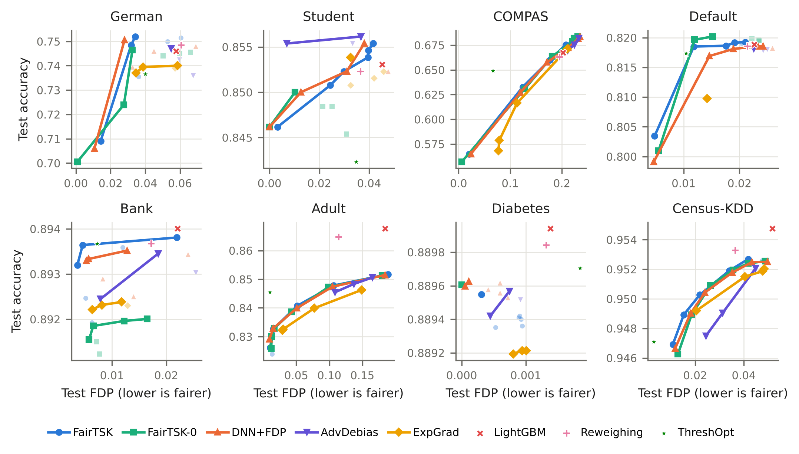
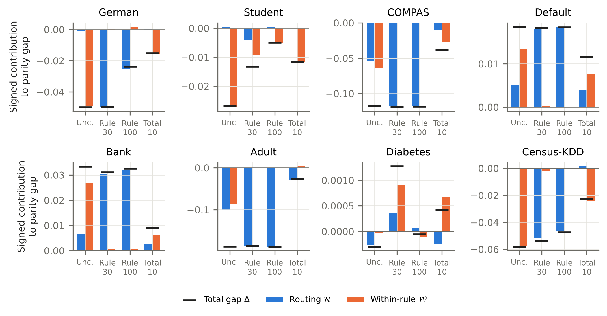

# 5. Experimental setup

**Datasets.** We use eight public tabular datasets that are standard in fairness research [@lequy] (@tbl:datasets): German Credit [@german], Student Performance [@student], COMPAS [@compas], Default of Credit Card Clients [@default], Bank Marketing [@bank], Adult [@adult], Diabetes 130-US Hospitals [@diabetes] and Census-Income (KDD) [@censuskdd]. Three leakage problems were removed: the call duration in Bank, which is known only after the outcome [@bank]; the period grades G1 and G2 in Student; and patient overlap in Diabetes, which is split by patient. The COMPAS risk score is not an input. Census-KDD uses a stratified subsample of 60,000 training instances per split. The protected attribute is never an input. For German and Bank the group is the fuzzy set *young*, and the crisp baselines use its core (age ≤ 25); elsewhere the group is crisp, so that FDP is classical demographic parity (Proposition 1). We follow the benchmark convention [@lequy] for the protected attribute; by Proposition 1(iii) FDP does not depend on which group is called protected, which matters for Default, where women have the higher favourable rate. Diabetes is a *control* with almost equal rates. A ninth setting tests the fuzzy group on a large dataset: Adult with *young* as the protected group (age and sex are not inputs; favourable rate 0.02 for age ≤ 25 and 0.07 membership-weighted, against 0.30 for age > 25), run with the full protocol on 10 splits and reported separately (Sections 6.1 and 6.3).

**Table {#tbl:datasets}.** Datasets after preprocessing: $n$ instances, $d$ encoded features, and the favourable-outcome rate overall, in the group $G$ and in its complement (membership-weighted for fuzzy groups).

| **Dataset** | $n$ | $d$ | **Group** $G$ | $P(Y = 1)$ | $P(Y = 1 \mid G)$ | $P(Y = 1 \mid \neg G)$ |
|---|---|---|---|---|---|---|
| German | 1,000 | 60 | fuzzy *young* | 0.700 | 0.638 | 0.739 |
| Student | 649 | 54 | sex (male) | 0.846 | 0.812 | 0.869 |
| COMPAS | 6,172 | 9 | race (African-American) | 0.545 | 0.477 | 0.617 |
| Default | 30,000 | 31 | sex (female) | 0.779 | 0.792 | 0.758 |
| Bank | 45,211 | 49 | fuzzy *young* | 0.117 | 0.153 | 0.110 |
| Adult | 45,222 | 86 | sex (female) | 0.248 | 0.114 | 0.312 |
| Diabetes | 101,763 | 221 | race (African-American) | 0.888 | 0.888 | 0.889 |
| Census-KDD | 299,285 | 469 | sex (female) | 0.062 | 0.025 | 0.102 |

**Compared methods.** All methods receive the same inputs, splits and preprocessing.

- Unconstrained references: logistic regression (LR), LightGBM [@lightgbm] and a two-layer ReLU network (DNN).
- Reweighing [@kamiran] on LightGBM; Exponentiated Gradient [@agarwal] with an LR base learner (Fairlearn [@fairlearn]); adversarial debiasing [@zhang]; Threshold Optimizer [@hardt], which uses the group label at prediction time.
- **DNN+FDP**, the DNN trained with exactly the FDP penalty of FairTSK. It shares FairTSK's objective but not its architecture, so a difference between the two isolates the rule base.
- Interpretable fairness-aware models: the fair decision tree of Barata et al. [@barata] (package fair-trees 3.1.9) and FairCORELS rule lists [@aivodji] (version 1.0) on binarised inputs.
- On German and Bank, where the sensitive variable is numeric: the DNN with a covariance penalty on age, with a kernel-density HGR-type penalty [@mary], and logistic regression with the covariance constraint of Zafar et al. [@zafar] on the crisp group or on age.
- FairTSK (total penalty), FairTSK-0 (zero-order) and FairTSK-rule (rule-local penalty (5)), with $L = 16$; the $\lambda_f = 0$ member of each family is the unconstrained TSK model.

Each family is run on a small fixed grid of its trade-off parameter; the grids and all hyperparameters, with their origin (a priori, pilot or validation), are listed in @stbl:hyper. No hyperparameter was tuned on test data.

**Protocol.** Data are split 60/20/20, stratified by label and group, on 10 random splits (5 for Diabetes and Census-KDD). Networks and TSK models are trained with Adam [@adam] for at most 100 epochs with early stopping on the validation objective. For each family, split and parity target $\epsilon = 0.05$, the *operating point* is the configuration with the highest validation accuracy among those with validation FDP ≤ $\epsilon$ (else the smallest validation FDP). Each family's whole trade-off is summarised by the normalised hypervolume (HV) [@zitzler] of its (FDP, accuracy) points with reference point (FDP = 0.2, majority-class accuracy):
$$\mathrm{HV} = \frac{1}{(1 - \text{acc}_{\text{ref}})\cdot 0.2}\ \mathrm{area}\Big(\bigcup_i\,[\text{FDP}_i,\,0.2] \times [\text{acc}_{\text{ref}},\,\text{acc}_i]\Big). \tag{7}$$
HV favours families with more configurations and, computed from all test points, selects the front on test data. We therefore also report the HV of the *validation-selected front* (configurations non-dominated on validation data, evaluated on test data), and a sensitivity analysis for the reference FDP of 0.1 and 0.3.

**Statistics.** Random splits share most of their training data, so all cross-dataset inference uses one value per dataset, the mean over its splits ($N = 8$): the Friedman test, and Wilcoxon signed-rank tests of FairTSK against each competitor with Holm's correction [@demsar; @holm]. With $N = 8$ the smallest two-sided Wilcoxon $p$-value is 0.0078, so these tests have little power. For FairTSK versus DNN+FDP we report 90% confidence intervals of the dataset-level difference; no equivalence margin was fixed in advance, so we do not claim equivalence [@schuirmann]. Comparisons over the splits of one dataset use the Nadeau–Bengio corrected resampled $t$-test [@nadeau].

**Synthetic study.** To test Theorem 2 where $\eta$ is known, $x = (z_1,z_2,z_3) \sim \mathcal{N}(0,I_3)$ and $Y \mid x \sim \mathrm{Ber}(\eta(x))$ with a linear logit $-0.5 + 1.5z_1 + z_2 - z_3$ or a nonlinear logit $-0.5 + 1.5z_1 + 2\sin(2.5z_2) + 1.5z_2z_3$. A latent age $a = 40 + 10(\rho z_1 + \sqrt{1 - \rho^2}\,e)$, $e \sim \mathcal{N}(0,1)$, not an input, defines $\mu = \mu_{\text{young}}(a)$; $\rho$ sets how much group information the inputs carry. Routing capacity is varied through $L \in \{1,2,4,8,16,32\}$ and by freezing the antecedents. Each configuration is trained without penalty, with the rule-local penalty and, for selected configurations, with the total penalty ($\lambda = 100$), on 20,000/10,000/50,000 training, validation and test points with 5 seeds: 700 runs over $\rho \in \{0,0.3,0.6,0.9\}$ (linear) and $\rho = 0.6$ (nonlinear). $\varepsilon(f)$ is estimated by Monte Carlo as the mean Bernoulli divergence over the 50,000 test inputs, and $\varepsilon_\Omega$ is bounded by the excess risk $\hat\varepsilon_0$ of a zero-order rule base with the same $L$ and antecedent mode. To check Corollary 3, 80 rule-local runs ($\rho = 0.6$, $L \in \{2,4,8,16\}$, trainable antecedents) were repeated under the regularised objective (3) with early stopping and under a *plain* protocol (log-loss and penalty only, 100 epochs, last iterate).

**Implementation and use of AI tools.** All models are implemented in PyTorch [@pytorch], except LR (scikit-learn), LightGBM and the Fairlearn baselines; runs used one CPU thread with fixed seeds. Code, per-split results and the scripts that regenerate every table and figure are publicly available [@software]. Claude (Anthropic), a large language model, was used to assist with literature search, drafting and language editing, writing and debugging the experimental code, and producing tables and figures from the results. All results were computed by the released code; the author reviewed all content, verified the proofs and the results, and takes full responsibility for the article.

# 6. Results

## 6.1 Accuracy–fairness trade-off

@tbl:hv reports the HV of each family's test front, @fig:pareto the fronts and @tbl:stats the dataset-level comparisons; operating points and further metrics are in @stbl:oppoint and @stbl:full.

**Table {#tbl:hv}.** Normalised hypervolume (7) of the test accuracy–FDP front (mean ± s.d. over splits; higher is better). Best per dataset in bold.

{{TABLE:hv}}

{#fig:pareto}

**Table {#tbl:stats}.** Dataset-level comparison of FairTSK with each fairness-aware method ($N = 8$; one value per dataset). Δ = FairTSK minus competitor; wins = datasets with larger test-front HV; $p_{Holm}$: Wilcoxon signed-rank test, Holm-adjusted within each column group. Confidence intervals are not adjusted for multiplicity.

{{TABLE:stats}}

*The penalty works where the gap is large, at a cost.* On Adult, FDP falls from about 0.18 (LR, LightGBM) to 0.05 or below for DNN+FDP, FairTSK and FairTSK-0, at about three accuracy points. On COMPAS, where base rates differ by 0.14, closing the gap costs about eleven points, and the operating points at $\epsilon = 0.05$ are close to trivial: accuracy 0.557–0.565 against a majority rate of 0.545, balanced accuracy 0.51–0.52, F1 0.71 (0.705 for predicting the positive class for everybody). The penalty also has a side effect that parity does not measure: on Adult the equalised-odds difference rises from 0.08–0.10 for the unconstrained models to 0.22–0.25 for DNN+FDP, FairTSK and FairTSK-0 (@stbl:eo). Threshold Optimizer, which uses the group label at prediction time, has the best front on COMPAS and Adult.

*FairTSK and DNN+FDP cannot be distinguished.* Their dataset-level HV difference is +0.0005 (90% CI [−0.0012, +0.0022]) on test fronts and −0.0029 ([−0.0077, +0.0019]) on validation-selected fronts, and the accuracy difference at $\epsilon = 0.05$ is +0.0001 ([−0.0006, +0.0009]). The rule base does not improve the attainable trade-off; its value must come from what it makes visible.

*No reliable advantage over the other baselines.* On test fronts, FairTSK has the larger HV than Exponentiated Gradient on all eight datasets (Holm-adjusted $p = 0.047$), and no other comparison is significant; on validation-selected fronts none is (smallest $p_{Holm} = 0.23$). The Friedman test gives $p = 0.017$ on test fronts, with DNN+FDP and FairTSK best ranked (2.25 and 2.62; Nemenyi critical difference 3.19, @sfig:cd), and $p = 0.071$ on validation-selected fronts. The advantage over Exponentiated Gradient is also sensitive to the HV reference point (Holm-adjusted $p = 0.12$ for a reference FDP of 0.1) and to excluding the uninformative Diabetes control ($p = 0.09$–$0.16$), whereas the absence of any difference from DNN+FDP is not (@stbl:hvref). Removing split 0, which was also used in the pilot runs, changes no conclusion (@stbl:split0). With a LightGBM base learner on the same grid, Exponentiated Gradient has a larger HV than with LR on six datasets and the remaining advantage disappears: FairTSK is better on four datasets, within 0.001 on two and worse on Adult and Census-KDD (mean difference +0.011, Wilcoxon $p = 0.38$; @stbl:egb).

*Interpretable models.* The fair decision tree and FairCORELS are far shorter (16–61 leaves; 1–5 rules) and reach about the same front as FairTSK on Default, Student and Diabetes; the tree is better on Student. On the datasets with many informative features they are clearly worse (test-front HV on Adult 0.354 for FairTSK against 0.225 and 0.180; Census-KDD 0.219 against 0.081 and 0.033; German 0.172 against 0.089 and 0.045), but across all eight datasets neither difference is significant after Holm adjustment ($p = 0.11$; @stbl:interp). Where a short tree or rule list reaches the same front, it is the more transparent choice.

*A third fuzzy group.* On Adult with the fuzzy group *young* (@stbl:adultage), FairTSK has the largest test-front HV among the methods that do not use the group at prediction time (0.188, against 0.150 for DNN+FDP and 0.146 for FairTSK-0; Holm-adjusted Nadeau–Bengio $p = 0.27$ for both) and a larger one than Reweighing, Exponentiated Gradient and adversarial debiasing ($p_{Holm} \leq 0.003$); Threshold Optimizer has the best front (0.226). This gap is the hardest in the study: with the penalty grid of the main comparison no in-processing family reached FDP $\leq 0.05$ on validation data, so the operating points are the least unfair configurations (FairTSK: accuracy 0.820, FDP 0.087).

## 6.2 Fuzzy groups versus continuous-attribute penalties

Proposition 2 makes FDP a covariance penalty on the membership $\mu$. Is it then equivalent to a covariance or HGR penalty on age? @tbl:continuous compares them on German and Bank with the same DNN, splits and selection protocol.

**Table {#tbl:continuous}.** FDP for the fuzzy group *young* versus continuous-attribute penalties (10 splits; means, standard deviations of HV 0.008–0.039). HV on the front of accuracy against FDP for *young*; operating point at $\epsilon = 0.05$; abs. corr(age): absolute correlation between test decisions and age. Δ HV = method minus DNN+FDP; $p_{Holm}$: Nadeau–Bengio test, Holm-adjusted over eight comparisons.

{{TABLE:continuous}}

Each penalty reduces what it targets. The covariance and HGR penalties on age lower the overall age correlation of decisions to 0.022–0.032 but leave the gap for the young at 0.017–0.028; FDP lowers that gap to 0.014. None of the HV differences is significant (all $p_{Holm} \geq 0.23$), so they are directional only. But FDP does something the paper criticises elsewhere: on Bank, it *increases* the age correlation of decisions from 0.055 to 0.086. A separate experiment (DNN and FairTSK, $\lambda_f = 0$ and 10, 10 splits; @stbl:ageaxis) shows where the disparity goes. Without a penalty, the young and the over-60s are both favoured in Bank (subscription rate 0.067 and 0.268 above the overall rate for the DNN). FDP removes the advantage of the young (0.001) but *raises* that of the over-60s to 0.323 (Nadeau–Bengio $p = 0.010$; FairTSK: 0.217 to 0.259, $p = 0.19$). FDP for a named group is thus itself a local constraint along the age axis, and it can displace disparity to an unprotected age band. A group specification protects only the group specified; the choice of a group, and the audit of the bands it leaves out, cannot be delegated to the penalty.

## 6.3 Displacement on real data

@tbl:decomp splits the score-level gap of every trained TSK model into $\mathcal R$ and $\mathcal W$ (Theorem 1) for the unconstrained model, the rule-local penalty and the total penalty; @fig:decomp shows the same numbers.

**Table {#tbl:decomp}.** Theorem 1 decomposition on test data (signed routing $\mathcal{R}$ / signed within-rule $\mathcal{W}$, score level) and decision-level FDP, means over splits. "rule": rule-local penalty (5); "total": FDP penalty.

| **Dataset** | **λ=0:** $\mathcal{R}$ / $\mathcal{W}$ / FDP | **rule, λ=30:** $\mathcal{R}$ / $\mathcal{W}$ / FDP | **rule, λ=100:** $\mathcal{R}$ / $\mathcal{W}$ / FDP | **total, λ=10:** $\mathcal{R}$ / $\mathcal{W}$ / FDP |
|---|---|---|---|---|
| German | −0.001 / −0.049 / 0.060 | −0.050 / 0.000 / 0.072 | −0.025 / +0.002 / 0.036 | +0.001 / −0.016 / 0.032 |
| Student | 0.000 / −0.027 / 0.040 | −0.004 / −0.009 / 0.029 | 0.000 / −0.005 / 0.007 | 0.000 / −0.012 / 0.030 |
| COMPAS | −0.054 / −0.063 / 0.227 | −0.118 / −0.001 / 0.232 | −0.118 / 0.000 / 0.237 | −0.011 / −0.028 / 0.177 |
| Default | +0.005 / +0.013 / 0.021 | +0.018 / 0.000 / 0.022 | +0.018 / 0.000 / 0.022 | +0.004 / +0.008 / 0.018 |
| Bank | +0.007 / +0.027 / 0.022 | +0.030 / +0.001 / 0.016 | +0.032 / +0.001 / 0.024 | +0.003 / +0.006 / 0.004 |
| Adult | −0.101 / −0.086 / 0.189 | −0.186 / 0.000 / 0.189 | −0.188 / 0.000 / 0.187 | −0.030 / +0.003 / 0.015 |
| Diabetes | 0.000 / 0.000 / 0.001 | 0.000 / +0.001 / 0.001 | 0.000 / 0.000 / 0.001 | 0.000 / +0.001 / 0.001 |
| Census-KDD | −0.001 / −0.057 / 0.048 | −0.052 / −0.002 / 0.041 | −0.047 / 0.000 / 0.037 | +0.001 / −0.024 / 0.022 |

{#fig:decomp}

*Where the gap sits.* On Adult and COMPAS both terms are substantial: the groups are routed to different rules *and* treated differently within rules. On Census-KDD, German, Student and Bank the gap is almost entirely within-rule.

*The rule-local penalty removes $\mathcal W$ but not the gap* on the two datasets with a large gap. On Adult, $\mathcal W$ falls to zero while $\mathcal R$ grows from −0.101 to −0.188, and the decision-level FDP stays at 0.187–0.189 (score level: −0.187 and −0.188); on COMPAS it stays at 0.227–0.237. Accuracy is unchanged. The shift of $\mathcal R$ (0.087 on Adult, 0.064 on COMPAS) is an order of magnitude larger than its bootstrap standard deviation over test resamples (0.002–0.005 and 0.002–0.011; @stbl:calboot). The total penalty shrinks both terms (Adult FDP 0.015). On the other datasets the evidence is weaker. On Bank and Default the gap is about 0.02 to begin with; on Census-KDD the penalty lowers it from 0.048 to 0.037, so displacement is partial; on German and Student it lowers FDP to 0.036 and 0.007, so displacement does not occur, although with test sets of 200 and 130 instances these results are noisy (the bootstrap standard deviation of the German gap is 0.019–0.028, and FDP at $\lambda = 30$ is 0.072). Real data thus show complete displacement on two datasets, partial on one and none on two. With the fuzzy group *young* on Adult the result is the same as for sex: the rule-local penalty ($\lambda = 100$) removes $\mathcal W$ (−0.085 to 0.000) while $\mathcal R$ grows from −0.116 to −0.201, so the score-level gap stays at −0.201 against −0.200 and the decision-level FDP at 0.189 against 0.191 (Nadeau–Bengio $p = 0.79$; @stbl:adultagedec). The controlled test is in Section 6.4.

*Displacement does not depend on the regularisers or on fuzzy antecedents.* With the plain protocol (log-loss and rule-local penalty only, no early stopping), the penalty again removes $\mathcal W$ and leaves the gap in place (COMPAS FDP 0.211 without and 0.218 with it; Adult 0.183 and 0.177). A mixture of experts with a linear softmax gate instead of fuzzy antecedents [@jacobs], with the same consequents and training, shows the same pattern (COMPAS 0.228 and 0.231, Adult 0.185 and 0.185; @stbl:moe). Displacement is a property of models with learned routing and a locally constrained output, not of fuzzy systems; the fuzzy rule base contributes readable antecedents for the regions involved.

*Displacement is not an artefact of the weighting or of a loss of fit.* With the coverage and rates of either group as Oaxaca–Blinder reference instead of midpoints, $\mathcal W$ of the unconstrained model is −0.076 or −0.097 on Adult and −0.066 or −0.061 on COMPAS, and under the rule-local penalty it is 0.000 for all three weightings (@stbl:r6dec). Test log-loss is 0.318, 0.316 and 0.318 for the first-order, rule-local and zero-order models on Adult and 0.601, 0.600 and 0.600 on COMPAS: the first-order consequents add no measurable fit, which is the case in which Theorem 2 predicts that the rule-local penalty leaves the gap in place. On COMPAS the penalty reduces the usage-weighted norm of the consequent slopes from 1.15 to 0.28, moving the model towards a zero-order rule base; on Adult the norm changes little (1.77 to 1.60) and $\mathcal W$ vanishes nonetheless.

## 6.4 A controlled test of Theorem 2

@tbl:synthetic and @fig:synth report the synthetic study for $\rho = 0.6$. The retained gap is the ratio of the score-level gap after the penalty to the unconstrained gap.

**Table {#tbl:synthetic}.** Synthetic study ($\rho = 0.6$, mean ± s.d. over 5 seeds). $\hat\varepsilon_0$: excess risk of a zero-order rule base with the same $L$ and antecedent mode (an upper bound on $\varepsilon_\Omega$); $\Delta_0$: unconstrained score-level gap; retained gap = $\Delta_\lambda/\Delta_0$. The total penalty was run for all $L$ in the linear scenario and for $L \in \{1,16\}$ in the nonlinear one.

{{TABLE:synthetic}}

{#fig:synth}

- *Complete displacement when $\hat\varepsilon_0$ is small.* With trainable antecedents and $L \geq 2$ (linear) or $L \geq 4$ (nonlinear), $\hat\varepsilon_0 \leq 0.028$ nats and the rule-local penalty retains 0.99–1.01 of the gap while $|\mathcal W| \leq 0.0006$; the total penalty removes it (retained ≤ 0.01). The result is the same for $\rho = 0.3$ and $0.9$.
- *No displacement with one rule.* For $L = 1$ the rule-local penalty retains 0.01 of the gap, like the total penalty (Corollary 2).
- *Partial displacement when routing is restricted.* With frozen antecedents ($\hat\varepsilon_0$ = 0.13–0.24) the penalty retains 0.22–0.51 of the gap, and in the nonlinear scenario with $L = 2$ ($\hat\varepsilon_0 = 0.17$) 0.59 ± 0.24. The same penalty removes half to three quarters of the gap when the antecedents cannot move and none of it when they can, which shows directly that the gap is re-routed.

Further configurations fill the range of $\hat\varepsilon_0$ between 0.028 and 0.13 nats (@stbl:synthgap). With trainable antecedents and $L = 3$ in the nonlinear scenario ($\hat\varepsilon_0 = 0.061$) and with frozen centres but trainable widths and gates ($\hat\varepsilon_0 = 0.005$–0.125), the penalty retains 0.88–1.00 of the gap, at a cost of up to five accuracy points; with centres, widths and gates frozen, $\hat\varepsilon_0$ stays at 0.13 (linear) and 0.22 (nonlinear) up to $L = 128$, and the retained gap at 0.32–0.54. Near $\hat\varepsilon_0 = 0.13$ the retained gap is 0.88 in one configuration and 0.32 in another. $\hat\varepsilon_0$ is thus an upper bound that guarantees displacement when it is small, not a predictor of the retained share when it is not; what separates the cases is whether the memberships can move, and trainable widths and gates suffice. We do not claim a threshold. At decision level the retained gap is 0.99–1.02 in the configurations with complete displacement. The bound of Corollary 3 held in all 80 alignment runs under both protocols, with the observed deviation at most 0.21 of it; the regulariser and optimisation-gap terms that separate Corollary 3 from Theorem 2 were at most 0.018 and between −0.061 and +0.015 nats, and displacement was the same under both protocols (@stbl:align).

## 6.5 A rule-level audit and proxy removal

@tbl:audit shows the rules with the largest shares (Section 4.2) of the gap of a zero-order FairTSK on Adult (split 0), without a penalty and with $\lambda_f = 10$. For a zero-order rule base the gap is pure routing (Corollary 1). The table describes one model and is an illustration, not evidence about Adult; @tbl:proxy then repeats the experiment without the marital variables over 10 splits.

**Table {#tbl:audit}.** Rules with the largest centred share of the gap, zero-order FairTSK on Adult (split 0). Antecedents: the six with the largest relevance $\varrho_{lj}$, centres in original units ("<", ">": centre outside the observed range; "(absent)": the rule prefers the category to be absent). The share of rule $l$ is $(m_{l}^{G} - m_{l}^{\neg G})(g_{l} - c)$, with $c$ the mean score.

{{TABLE:audit}}

Without a penalty the gap (−0.195) has two sources: two high-score rules combining high age, education and hours with *married* status cover men about four times as heavily as women, and three low-score rules combining low education and few hours with the *absence* of married status cover women 2.1–2.6 times as heavily as men. With the penalty the gap shrinks to −0.031, partly through a high-score rule whose antecedents include *married* and *relationship = wife* and which covers women three times as heavily as men (+0.044): the penalty reduced the gap by targeting a subgroup of women through a proxy. The rules are readable but imperfect as linguistic statements. Labels such as *High* and *Low* are attached to learned Gaussian centres, not to a fixed linguistic partition; some centres lie outside the observed range; and some antecedents are redundant (e.g. *married* together with *never-married (absent)*).

**Table {#tbl:proxy}.** Adult with and without marital status and relationship (first-order FairTSK, test data, means over 10 splits, all s.d. below 0.01). Last columns: AUC for sex of the normalised firing of the four rules with the largest absolute share versus the other twelve, and single-feature AUC for sex of the three most relevant features of those four rules versus all features.

{{TABLE:proxy}}

Removing the two variables roughly halves the unconstrained gap (0.189 to 0.108) at a cost of 2.7 accuracy points, but displacement persists: under the rule-local penalty the gap is 0.102, with $\mathcal W = 0$ (the small reduction is not significant: Nadeau–Bengio $p = 0.08$). Only the total penalty closes the gap (0.058 at $\lambda = 10$). Without the marital variables, the firing of the four rules carrying the gap is slightly more associated with sex than that of the other rules (AUC 0.612 versus 0.575, Nadeau–Bengio $p = 0.003$), and their most relevant features are slightly more associated with sex than the average feature (0.557 versus 0.512, $p < 0.001$), led by hours per week (single-feature AUC 0.65). These are small effects. The same features would be found by a feature-level attribution of the gap [@begley]. What the decomposition adds is the information that the gap now runs *between* rules rather than within them, which is exactly what a within-rule audit would miss.
