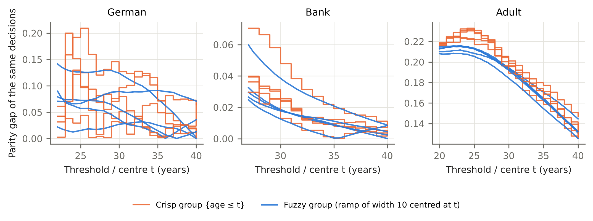
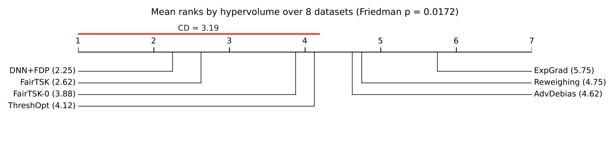
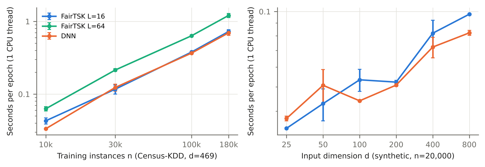

Online Resource 1 to the article submitted to *Knowledge and Information Systems*.

Rahib Imamguluyev, Department of Information Technologies, Baku Business University, 88a H. Zardabi St., Baku AZ1122, Azerbaijan; e-mail: rahib.aydinoglu@gmail.com (corresponding author)

Section, equation, proposition and table numbers without the prefix S refer to the main article. All numbers below were computed by the released code [@software].

# S1. Hyperparameters and protocol details

**Table {#tbl:hyper}.** Hyperparameters and their origin. "A priori": fixed before any experiment. "Pilot": chosen in pilot runs on split 0 of Adult and German for rule sparsity and training stability. "Validation": selected per split on validation data. Grids: Exponentiated Gradient $\epsilon \in \{0.01,0.02,0.05,0.1\}$; adversarial debiasing $\alpha \in \{0.3,1,3\}$; DNN+FDP, FairTSK and FairTSK-0 $\lambda_f \in \{0,1,3,10,30,100\}$; FairTSK-rule $\lambda \in \{3,30,100\}$; covariance and HGR penalties $\lambda \in \{1,3,10,30,100,300\}$ ($\{0.3,\dots,100\}$ for HGR); fair tree $\theta \in \{0,0.1,0.2,0.3,0.5,0.7,0.9\}$, depth 4 or 6; FairCORELS maximum training unfairness $\{0.01,0.02,0.05,0.1\}$ and unconstrained, rules of one condition, minimum support 0.01, $c = 10^{-3}$, search budget $2 \times 10^5$ nodes, numeric inputs binarised at training quintiles.

{{TABLE:hyper}}

**Pilot choices.** On Adult, gate penalties $\lambda_{\gamma} \in \{10^{-3},10^{-2},3\cdot10^{-2},10^{-1}\}$ gave accuracies of 0.8458–0.8464; $10^{-2}$ was chosen because larger values made the zero-order model on the small datasets nearly constant. $\lambda_{a} = 10^{-2}$ was chosen among $\{10^{-3},10^{-2},3\cdot10^{-2}\}$, which did not affect accuracy. The mini-batch size was made dependent on the training-set size after the zero-order model failed to leave its initial constant prediction on German with batches of 256. Split 0 is also an evaluation split; repeating all dataset-level tests without it leaves the conclusions unchanged (FairTSK minus DNN+FDP HV difference +0.0034, 90% CI [−0.0016, +0.0085]; Friedman $p = 0.018$).

# S2. Specification of the protected group

**Proposition S1 (Stability with respect to the membership function).** Let $\mu,\mu'$ satisfy $\|\mu - \mu'\|_{\infty} \leq \varepsilon$, with means in $[\pi_{0},1 - \pi_{0}]$, and let $v_{0} := \pi_{0}(1 - \pi_{0})$. Then for any $h$ with values in $[0,1]$, $|\Delta_{G}(h) - \Delta_{G'}(h)| \leq \frac{\varepsilon}{2v_{0}}(1 + v_{0}^{-1/2})$.

*Proof.* Let $v = \pi(1 - \pi)$ and $C = \mathrm{Cov}(\mu,h)$, and $v',C'$ analogously. (1) $|C - C'| = |\mathbb{E}[(\mu - \mu')(h - \mathbb{E}h)]| \leq \varepsilon\sqrt{\mathrm{Var}\,h} \leq \varepsilon/2$. (2) $\mathrm{Var}\,\mu \leq v$, so $|C| \leq \sqrt{v}/2$. (3) $|v - v'| \leq \varepsilon$. Hence $|C/v - C'/v'| \leq |C - C'|/v' + |C|\,|v - v'|/(v v') \leq \varepsilon/(2v_0) + \varepsilon/(2v_0^{3/2})$. $\square$

For memberships $\mu_t(z) = S((t - z)/s)$ with a 1-Lipschitz $S$, $t \mapsto \Delta_{G_t}(h)$ is therefore Lipschitz with constant $(1 + v_{0}^{-1/2})/(2v_{0}s)$. On German ($v_0 \approx 0.0475$, $s = 10$ years) the constant is about 5.9 per year, larger than any gap, so the bound is qualitative. For crisp groups and integer ages, $t \mapsto \Delta_{\{z \leq t\}}$ is a step function with a jump at every atom.

**Measurement experiment.** On German, Bank and Adult (for Adult with age as the sensitive variable for this experiment only), DNN and FairTSK were trained without a penalty, with the penalty on the crisp group age ≤ 25 and with the penalty on *young* ($\lambda_f = 10$, 5 splits). For the test decisions of each of the 90 models, the crisp gap for $\{\text{age} \leq t\}$ and the fuzzy gap for a ramp of width 10 centred at $t$ were computed for $t$ from 20 to 40 in steps of 0.5 (both groups ≥ 5% of the data). A linear ramp is the average of crisp indicators over its window, so the fuzzy curve is a smoothed crisp curve by construction; the experiment measures the size of the effect. For all 90 models the crisp curve had the larger total variation (on average 0.158 versus 0.063) and the larger largest step (0.029 versus 0.004; @fig:threshold). On German, moving the crisp threshold past a single integer age changes the measured gap of the same decisions by up to 0.16. Training against the fuzzy group did not make models more robust to the crisp threshold (@tbl:threshold): across the 30 paired runs, it gave a slightly larger maximum crisp gap (+0.014, Wilcoxon $p = 0.028$) and higher accuracy (+0.008, $p < 0.001$) than training against the crisp group.

{#fig:threshold}

**Table {#tbl:threshold}.** Models trained without penalty, with the crisp-group penalty and with the fuzzy-group penalty ($\lambda_{f} = 10$, 5 splits). Gaps are measured on test decisions; "max" and "mean" over the valid thresholds in parentheses.

{{TABLE:B1}}

**Location of the group.** @tbl:ramp trains models against one specification of *young* (crisp ≤ 25, or ramps ending at 30, 35 or 45) and evaluates them against all four. The measured gap of the same unconstrained Bank DNN is 0.071 for the crisp group and 0.046, 0.025 and 0.008 for ramps ending at 30, 35 and 45. A model trained against the 25–35 ramp transfers well (Bank DNN: 0.006–0.011 under all four); one trained against the wide 25–45 ramp leaves a crisp gap of 0.042.

**Table {#tbl:ramp}.** Cross-evaluation of group specifications ($\lambda = 10$; decision-level test gaps, means over splits).

{{TABLE:ramp}}

**Shape of the transition.** @tbl:shape varies the shape at a fixed crossover ($\mu = 0.5$ at 30 years): linear 25–35, a C¹ Z-spline on the same support, a sigmoid with scale 2 years, and a plateau-free ramp 18–35. On Bank, models trained against any fuzzy specification have gaps of 0.003–0.006 under every fuzzy specification, and the three shapes with the same crossover measure the gap of the unconstrained DNN as 0.023–0.029. The normative content lies in the location of the group, not in the form of the transition.

**Table {#tbl:shape}.** Shape of the membership function ($\lambda = 10$; decision-level test gaps, means over splits).

{{TABLE:B3}}

# S3. Additional results of the main comparison

**Table {#tbl:oppoint}.** Test accuracy / FDP at the operating point selected on validation data for $\epsilon = 0.05$ (mean over 10 splits; 5 for Diabetes and Census-KDD).

{{TABLE:oppoint}}

**Table {#tbl:full}.** Full results at the operating point for $\epsilon = 0.05$ (mean ± s.d. over splits). EO diff.: equalised-odds difference (crisp group). HV of the test front for families with a trade-off.

{{TABLE:A1}}

**Table {#tbl:eo}.** Equalised-odds difference at the operating point ($\epsilon = 0.05$; mean over splits).

{{TABLE:eo}}

**Table {#tbl:hvref}.** Sensitivity of the dataset-level comparison to the HV reference point and to excluding the Diabetes control. Cells: mean HV difference FairTSK minus competitor (Holm-adjusted Wilcoxon $p$).

{{TABLE:hvref}}

**Table {#tbl:split0}.** Dataset-level comparison with split 0, which was also used in the pilot runs, removed (Wilcoxon over datasets, Holm-adjusted; confidence intervals unadjusted).

{{TABLE:split0}}

**Evaluation against the crisp core group.** On German and Bank the fuzzy-group methods are trained against *young*, whereas the crisp baselines are trained against its core (age ≤ 25). To check that this does not favour the fuzzy-group methods, @tbl:crispeval evaluates every family against the crisp core: the HV of the front of accuracy against the crisp gap, and the operating point selected on the validation crisp gap ($\epsilon = 0.05$). The fuzzy-penalty families keep the largest HV on both datasets (German: FairTSK-0 0.174, FairTSK 0.161, DNN+FDP 0.158 against at most 0.110 for the crisp baselines; Bank: DNN+FDP and FairTSK 0.093 against at most 0.086).

**Table {#tbl:crispeval}.** German and Bank evaluated against the crisp group age ≤ 25 (means over 10 splits).

{{TABLE:crispeval}}

**Table {#tbl:egb}.** Exponentiated Gradient with a LightGBM base learner (100 trees, learning rate 0.1, 31 leaves; same grid $\epsilon \in \{0.01,0.02,0.05,0.1\}$) compared with the LR base learner of the main comparison and with FairTSK: test-front HV and operating point at $\epsilon = 0.05$ (means over splits). On COMPAS no configuration met $\epsilon = 0.05$ on validation data in any split, and the least unfair one is reported. Dataset-level difference FairTSK minus Exponentiated Gradient (LightGBM): +0.011, Wilcoxon $p = 0.38$.

{{TABLE:egb}}

**Table {#tbl:adultage}.** Adult with the fuzzy group *young* as protected group (age and sex are not inputs; 10 splits; means, HV with s.d.). Operating point: no in-processing family reached validation FDP $\leq 0.05$ with the penalty grid of the main comparison, so the least unfair configuration is reported; Threshold Optimizer met it in 4 of 10 splits. Crisp gap: decision-rate difference for the core age $\leq 25$. Δ HV: FairTSK minus competitor, Nadeau–Bengio test, Holm-adjusted over six comparisons.

{{TABLE:adultage}}

{#fig:cd}

**Table {#tbl:interp}.** FairTSK versus interpretable fairness-aware models: test accuracy / FDP at the operating point ($\epsilon = 0.05$), HV of the test front and of the validation-selected front, and model size at the operating point (leaves; rules of the list including the default rule). Means over splits. Dataset-level differences FairTSK minus fair tree / FairCORELS: test-front HV +0.047 (90% CI [+0.006, +0.088]) / +0.063 ([+0.006, +0.119]), Holm-adjusted $p = 0.11$ for both; validation-selected fronts $p = 0.30$.

{{TABLE:interp}}

**Calibration.** Without a penalty, FairTSK and the DNN are equally well calibrated (ECE 0.010–0.012 on Adult, 0.035–0.038 on COMPAS). The parity penalty worsens calibration within groups for both, as expected when parity is enforced against unequal base rates: on Adult the within-group ECE rises from 0.016–0.019 to 0.066–0.106 at $\lambda_f = 10$, while the overall ECE stays below 0.02 (@tbl:calboot).

**Table {#tbl:calboot}.** Calibration and bootstrap variability of the decomposition (test data, means over 10 splits). ECE: expected calibration error (15 bins), overall and within the crisp group and its complement; bootstrap s.d.: over 1,000 test-set resamples for the fixed trained model.

{{TABLE:B4}}

# S4. Where FDP moves disparity along the age axis

**Table {#tbl:ageaxis}.** Decision rate in each age band minus the overall decision rate (test data, means over 10 splits), without penalty ($\lambda = 0$) and with the FDP penalty for *young* ($\lambda = 10$). The last rows give the mean number of test instances per band; the German bands above 45 are small.

{{TABLE:ageaxis}}

# S5. Decomposition: further results

**Corollary S1 (Bound).** With $D := \max_{l}\bar{r}_{l} - \min_{l}\bar{r}_{l}$ and $TV(m^{G},m^{\neg G}) = \frac{1}{2}\sum_{l}|m_{l}^{G} - m_{l}^{\neg G}|$, $\mathrm{FDP}_{G}(\hat{y}) \leq TV\cdot D + \sum_{l}\bar{m}_{l}\,|r_{l}^{G} - r_{l}^{\neg G}|$. *Proof.* Choose $c$ as the midpoint of the $\bar r_l$ in $\mathcal R = \sum_l (m_l^G - m_l^{\neg G})(\bar r_l - c)$; the second term is the triangle inequality. $\square$ Hence $\mathrm{FDP}_G(\hat y) = 0$ if $r_l^G = r_l^{\neg G}$ for all $l$ and either $m^G = m^{\neg G}$ or all $\bar r_l$ are equal.

**Table {#tbl:scoredec}.** Pearson correlation between the absolute score-level gap and the decision-level FDP over the trained TSK models of the main comparison (FairTSK, FairTSK-0, FairTSK-rule; all splits and penalty weights). On Diabetes both gaps are essentially zero.

{{TABLE:scoredec}}

**Table {#tbl:moe}.** Mixture of experts with a linear softmax gate instead of fuzzy antecedents (16 experts, same consequents, load balancing, sparsity and training protocol; test data, mean ± s.d. over splits; $\mathcal R$ and $\mathcal W$ at score level).

{{TABLE:moe}}

**Table {#tbl:r6dec}.** Fit and decomposition of first-order (FairTSK, $\lambda_f = 0$), rule-local (FairTSK-rule, $\lambda = 100$) and zero-order (FairTSK-0, $\lambda_f = 0$) rule bases (test data, means over 10 splits; s.d. of the log-loss at most 0.007). Cons. norm (mean ± s.d.): usage-weighted Euclidean norm of the consequent slopes per standard deviation of each input. $\mathcal R$ / $\mathcal W$ at score level with the midpoint weights of (4); reference ¬G: rates of ¬G in $\mathcal R$ and coverage of G in $\mathcal W$; reference G: the converse. All three sum to the gap.

{{TABLE:r6dec}}

**Table {#tbl:adultagedec}.** Theorem 1 decomposition for the fuzzy group *young* on Adult (FairTSK, test data, means over 10 splits; $\mathcal R$, $\mathcal W$ and the gap at score level).

{{TABLE:adultage_dec}}

**Sanity checks.** In both audited models of @mtbl:audit, the rule shares sum to the directly computed score-level gap to four decimals, and the bound of Proposition 3 held in all 700 synthetic runs (largest ratio of deviation to bound 0.67). Lemma 1, Proposition 3 and Corollary 2 were also checked numerically on 2,000 random instances without violation. These checks verify the code, not the results.

# S6. Alignment of Theorem 2 with training

**Table {#tbl:align}.** Synthetic data ($\rho = 0.6$, trainable antecedents, rule-local penalty $\lambda = 100$, mean over 5 seeds). "Plain": log-loss and rule-local penalty only, 100 epochs, last iterate; "regularised": objective (3) with early stopping. $\Psi(f')$ and $\delta$: regulariser value of the zero-order reference and relative optimisation gap of Corollary 3 (nats), with $\Omega(f') = 0$ as Lemma 1(b) requires; certificate: the bound of Corollary 3 on $|\Delta_G(\hat f) - \Delta_G(\eta)|$. Both bounds of Corollary 3 held in all 80 runs; the largest ratio of deviation to certificate was 0.21.

{{TABLE:align}}

**Table {#tbl:synthgap}.** Synthetic configurations with zero-order excess risk between the design points of Section 6.4 ($\rho = 0.6$, mean ± s.d. over 5 seeds, rule-local penalty $\lambda = 100$). Centres frozen: Gaussian centres fixed at their k-means++ initialisation, widths, feature gates and consequents trained; frozen: centres, widths and gates fixed. $\hat\varepsilon_0$: excess risk of a zero-order rule base with the same $L$ and antecedent mode; retained gap = $\Delta_\lambda/\Delta_0$ at score level.

{{TABLE:synthgap}}

# S7. Compaction and stability of the attribution

**Table {#tbl:compact}.** Compact rule bases with $k = 3$ antecedents per rule, ranked by $\varrho_{lj}$ (unconstrained and $\lambda_f = 10$ models, 3 splits). Fidelity: agreement of test decisions with the full model; abs. Δgap: absolute change of the score-level gap; contribution corr.: correlation of the 16 centred rule shares before and after compaction; top-4 overlap: share of the four largest-share rules that remain among the four largest. Active rules and consequent weights: selected first-order models.

{{TABLE:compact}}

Compact rule bases keep the decisions of first-order models (mean fidelity 0.983) and the total gap (mean absolute change 0.004), but not the rule-level attribution: the shares correlate at 0.86 (first-order) and 0.53 (zero-order), the four largest-share rules are preserved in 82% and 52% of cases, and for zero-order models on Bank and Adult the correlation is −0.01 and 0.12. Ranking antecedents by $\varrho_{lj}$ instead of the non-identifiable gate leaves first-order fidelity unchanged (0.983 versus 0.984) and raises zero-order fidelity from 0.859 to 0.880. Compacting the consequents instead (the five terms with the largest $|a_{lj}|\,\mathrm{sd}(x_j)$ per rule) is less faithful (fidelity 0.84, share correlation 0.69, top-4 overlap 0.61) than compacting the antecedents (0.98, 0.87, 0.78), and compacting both is worse still (0.83, 0.58, 0.53). Audits should therefore be computed on the full model.

**Table {#tbl:stability}.** Stability of the feature-level attribution. Each rule's centred share is distributed over its features in proportion to the normalised $\varrho_{lj}$, giving a profile $\phi_j$ that sums to the gap and does not depend on the numbering of the rules; for the fair tree, each leaf's share is distributed equally over the features on its path. Spearman: mean pairwise rank correlation of $|\phi_j|$; top-5: mean pairwise overlap of the five features with the largest $|\phi_j|$, across 5 splits ($L = 16$) and across $L \in \{8,16,32\}$; chance top-5 $= 5/d$. $\lambda = 10$ for FairTSK corresponds to $\theta = 0.3$ for the tree (depth 4).

{{TABLE:stability}}

The five features that carry most of the gap agree across splits in 50–100% of cases without a penalty (32–82% with $\lambda_f = 10$), against 1–56% by chance, and across rule-base sizes in 68–97% (59–89%). Without a penalty the fair tree's attributions are less stable on six of eight datasets, equally stable on Adult and more stable on Diabetes; with the penalty the comparison is mixed.

# S8. Ablation and computational cost

Each epoch of FairTSK costs $O(nLd)$ time and $O(BL + Ld)$ memory per mini-batch of size $B$, with $L(4d + 1)$ parameters: (2) evaluates $L \times d$ standardised distances per sample, the consequents are $L$ inner products of length $d$, and the softmax and the regularisers of (3) add $O(L)$ and $O(Ld)$.

**Table {#tbl:ablation}.** Ablation (mean over 3 splits): accuracy at $\lambda_{f} = 0$, FDP at $\lambda_{f} = 10$, and normalised entropy of mean rule usage (1 = uniform) at $\lambda_{f} = 0$.

{{TABLE:B2}}

Accuracy without a penalty changes by at most 0.4 points when the number of rules varies from 4 to 64 or the temperature or the gates change; FDP under $\lambda_f = 10$ varies by up to 0.009 on Adult. Without load balancing the normalised entropy of rule usage falls from 1.00 to 0.56 on Adult and 0.75 on Bank, i.e. a few rules absorb most samples, which makes an audit less informative.

**Table {#tbl:scaling}.** Seconds per epoch (mean of 3 epochs, one CPU thread, batch size 1024) on Census-KDD.

{{TABLE:scaling}}

On Census-KDD ($d = 469$), the epoch time with 16 rules grows from 0.043 s at $n = 10{,}000$ to 0.726 s at $n = 179{,}571$, a factor of 16.9 for a 17.96-fold increase in $n$; at full size it is close to that of the DNN (0.696 s). Quadrupling the rules to 64 multiplies the epoch time by 1.66. On synthetic data with $n = 20{,}000$, increasing $d$ 32-fold from 25 to 800 multiplies it by 2.9 (@fig:scaling). A grid-partitioned ANFIS with three terms per input would need $3^{86} \approx 10^{41}$ rules on Adult.

{#fig:scaling}
